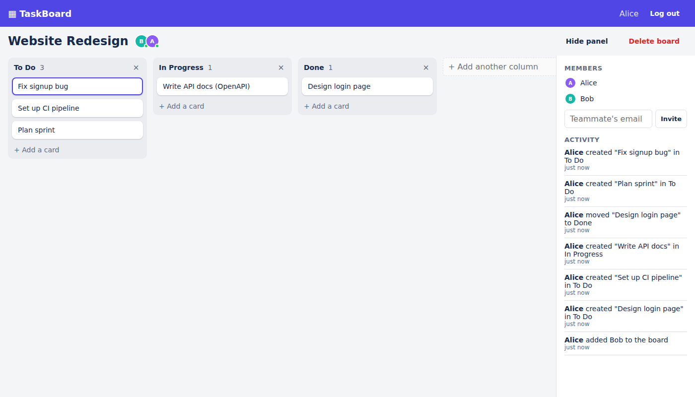
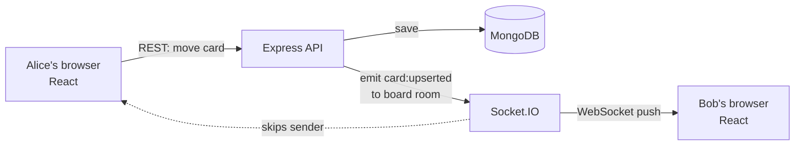

# TaskBoard: Real-Time Collaborative Kanban

A mini Trello. Create boards, add cards, and drag them between columns. When a teammate moves a card, **you see it move instantly, with no page refresh**.




## Features

- **Sign up / log in** with JWT authentication and bcrypt-hashed passwords
- **Boards** with default *To Do / In Progress / Done* columns; add, rename and delete columns
- **Cards** with title, description, due date and assignee
- **Drag and drop** within and across columns (keyboard accessible too)
- **Live sync** over WebSockets: every change appears on teammates' screens instantly
- **Who's online**: avatars show who's viewing the board right now
- **Activity log**: "Alice moved *Design login page* to Done"
- **Invite teammates** by email
- **Auto-recovery**: after a dropped connection the app rejoins and re-syncs automatically

## Tech stack

| Layer     | Technology                                                    |
|-----------|---------------------------------------------------------------|
| Frontend  | React 19, TypeScript, Vite, React Router, dnd-kit             |
| Backend   | Node.js, Express 5, Socket.IO, Zod validation                 |
| Database  | MongoDB with Mongoose                                          |
| Auth      | JWT, bcrypt, rate-limited login                               |
| Testing   | Jest, Supertest, socket.io-client, mongodb-memory-server      |
| DevOps    | Docker, Docker Compose, nginx, GitHub Actions CI              |

## Architecture



**What happens when Alice drags a card to "Done":**

1. Alice's screen updates immediately (*optimistic update*), so it feels instant.
2. The browser calls `POST /api/cards/:id/move` with the card's new neighbours.
3. The server checks that Alice is a board member, computes the new position and saves it.
4. The server broadcasts `card:upserted` to the Socket.IO **room** for that board, so only people viewing that board get it. Alice's own socket is skipped (she sent its id in the `x-socket-id` header) because her screen is already up to date.
5. Bob's browser receives the event and moves the card on his screen.
6. If the server rejects the move, Alice's board reloads from the server (rollback).

## Design decisions

**Fractional indexing for card order.** Each card has a numeric `position`. Dropping a card between positions `1024` and `2048` gives it `1536`. A move therefore updates **one** document instead of renumbering the whole column. If positions ever get too close to split (after many drops in the same spot), the server rebalances that column and broadcasts `cards:rebalanced`. There's a test that forces this.

**The server decides the position.** The client sends *which cards it landed between* (`beforeId` / `afterId`), not a raw number. The server looks up those neighbours in the database, so two users dragging at once can't corrupt the order. If a neighbour vanished mid-drag, the server returns `409` and the client re-syncs.

**Conflict rule: last write wins.** If two people edit the same card, the newest `updatedAt` wins on every screen. It's simple and predictable, which is a good fit for a task board.

**Resync on reconnect.** Events missed while offline aren't replayed. Instead, on reconnect the client rejoins the room and refetches the board, which is simpler and always correct.

**Privacy.** Non-members get `404` rather than `403` for boards they can't access, so board ids can't be probed. Socket connections must present a valid JWT, and joining a board room checks membership.

## Getting started

### Option 1: Docker (easiest)

Requires [Docker Desktop](https://www.docker.com/products/docker-desktop/).

```bash
docker compose up --build
```

Open **http://localhost:8080**. To try real-time sync, open a second browser (or an incognito window), sign up as a different user, invite them to your board, and drag a card.

### Option 2: Run locally

Requires Node.js 18+ and MongoDB running on `localhost:27017` (or run just the database with `docker compose up mongo`).

```bash
# 1. Backend
cd server
cp .env.example .env        # then edit JWT_SECRET
npm install
npm run dev                 # http://localhost:4000

# 2. Frontend (in a second terminal)
cd client
npm install
npm run dev                 # http://localhost:5173
```

In development, Vite forwards `/api` and `/socket.io` to the backend, so there's no CORS setup to do.

### Environment variables (`server/.env`)

| Variable         | Example                                  | Purpose                        |
|------------------|------------------------------------------|--------------------------------|
| `PORT`           | `4000`                                   | API port                       |
| `MONGO_URI`      | `mongodb://127.0.0.1:27017/taskboard`    | Database connection            |
| `JWT_SECRET`     | a long random string                     | Signs login tokens (required in production) |
| `JWT_EXPIRES_IN` | `7d`                                     | Token lifetime                 |
| `CLIENT_ORIGIN`  | `http://localhost:5173`                  | Allowed CORS origin(s), comma-separated |

## Running tests

```bash
cd server
npm test
```

The tests start an in-memory MongoDB automatically. To use your own database instead, set `TEST_MONGO_URI=mongodb://localhost:27017`.

27 tests cover:
- auth (register, login, bad tokens, duplicate emails, validation)
- board permissions (only members can see a board; only the owner can delete it)
- card ordering (midpoint inserts, cross-column moves, forced rebalancing)
- **real-time behaviour** with two live socket clients: Bob receives Alice's move, Alice is not echoed, presence updates on join and leave, and unauthorised sockets are rejected

GitHub Actions runs the server tests against a real MongoDB, plus the client lint and build, on every push.

## API reference

All routes except register/login need `Authorization: Bearer <token>`.

| Method | Route                                         | Description                       |
|--------|-----------------------------------------------|-----------------------------------|
| POST   | `/api/auth/register`                          | Create account → `{ token, user }` |
| POST   | `/api/auth/login`                             | Log in → `{ token, user }`         |
| GET    | `/api/auth/me`                                | Current user                      |
| GET    | `/api/boards`                                 | My boards                         |
| POST   | `/api/boards`                                 | Create board                      |
| GET    | `/api/boards/:id`                             | Board + all cards                 |
| PATCH  | `/api/boards/:id`                             | Rename board                      |
| DELETE | `/api/boards/:id`                             | Delete board (owner only)         |
| POST   | `/api/boards/:id/members`                     | Invite by email                   |
| POST   | `/api/boards/:id/columns`                     | Add column                        |
| PATCH  | `/api/boards/:id/columns/:columnId`           | Rename column                     |
| DELETE | `/api/boards/:id/columns/:columnId`           | Delete column and its cards       |
| GET    | `/api/boards/:id/activity`                    | Last 30 activity entries          |
| POST   | `/api/boards/:id/cards`                       | Create card                       |
| PATCH  | `/api/cards/:id`                              | Edit card                         |
| POST   | `/api/cards/:id/move`                         | Move card `{ columnId, beforeId, afterId }` |
| DELETE | `/api/cards/:id`                              | Delete card                       |

### Socket.IO events

| Direction        | Event              | Payload                     |
|------------------|--------------------|-----------------------------|
| client → server  | `board:join`       | `boardId` (acknowledged with `{ ok }`) |
| client → server  | `board:leave`      | `boardId`                   |
| server → client  | `card:upserted`    | card                        |
| server → client  | `card:deleted`     | `{ id }`                    |
| server → client  | `cards:rebalanced` | card[]                      |
| server → client  | `column:deleted`   | `{ columnId }`              |
| server → client  | `board:updated`    | board                       |
| server → client  | `board:deleted`    | `{ id }`                    |
| server → client  | `activity:new`     | activity entry              |
| server → client  | `presence`         | `[{ id, name }]` viewing now |

## Project structure

```
realtime-task-board/
├── server/
│   ├── src/
│   │   ├── models/        # User, Board (with embedded columns), Card, Activity
│   │   ├── routes/        # auth, boards (+ columns, members), cards
│   │   ├── middleware/    # JWT auth, zod validation, error handling
│   │   ├── utils/         # fractional positions, broadcasting, serializers
│   │   ├── socket.js      # Socket.IO auth, rooms, presence
│   │   ├── app.js         # Express app
│   │   └── index.js       # entry point
│   └── tests/             # Jest + Supertest + live socket tests
├── client/
│   └── src/
│       ├── pages/         # Login, Boards list, Board (drag & drop + live sync)
│       ├── components/    # Column, CardItem, CardModal, SidePanel, Avatar
│       └── lib/           # API client, socket, auth context, ordering helpers
├── docker-compose.yml
└── .github/workflows/ci.yml
```

## Possible next steps

- Scale out to multiple servers with the Socket.IO **Redis adapter**, keeping presence in Redis
- Card comments, labels and checklists
- Email invitations for people who don't have an account yet
- End-to-end browser tests with Playwright
- Deploy: frontend on Vercel/Netlify, backend on Render/Railway/AWS, database on MongoDB Atlas

## License

MIT
